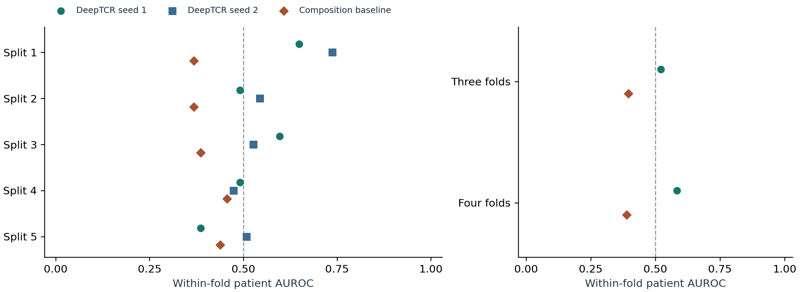

# T-cell receptor repertoires and response to CD19 CAR-T therapy

Mateenah Jahan and Sherry Bhalla · CSIR–Institute of Genomics and Integrative Biology

Can the T-cell receptor repertoire in an infusion product distinguish patients with a complete or partial response three months after axicabtagene ciloleucel? We evaluated DeepTCR in 34 patients with large B-cell lymphoma. Each patient's entire repertoire was held out together. Across ten evaluations, median within-fold patient AUROC was **0.518** (range 0.386–0.737). A logistic regression on repertoire composition scored **0.386** across the same five patient partitions. The median was close to chance, and performance varied across patient partitions. These 34 patients do not establish that the model can predict response in a new cohort.

[Read the research paper and supplement](paper/main.pdf) · [Presentation](results/DeepTCR_Results_Presentation.pptx)

The source study deposited 59 infusion products. Thirty-five had an evaluable three-month PET/CT outcome, and 34 of those had TCR contigs. Matching productive alpha and beta chains yielded 239,637 pair rows from 198,267 cells. The model scored 239,634 eligible rows and averaged the sequence scores within each held-out patient. [Source data](https://www.ncbi.nlm.nih.gov/geo/query/acc.cgi?acc=GSE241783) · [Cohort verification](validation/source-cohort/README.md)

| Study material | Location |
| --- | --- |
| Patient splits, paired AUROCs and training seeds | [Results by partition](validation/repeated-patient-cv/repeat_results.csv) · [Study design](validation/repeated-patient-cv/repeat_plan.json) |
| Fixed-partition scores, uncertainty and shuffled-label control | [Fixed-partition evaluation](validation/patient-grouped-deeptcr/REPORT.md) |
| Sensitivity to counting chains and exploratory cluster stability | [Source and sensitivity analyses](validation/source-cohort/README.md) |
| Run the models and build the paper | [Reproduction guide](SETUP.md) |
