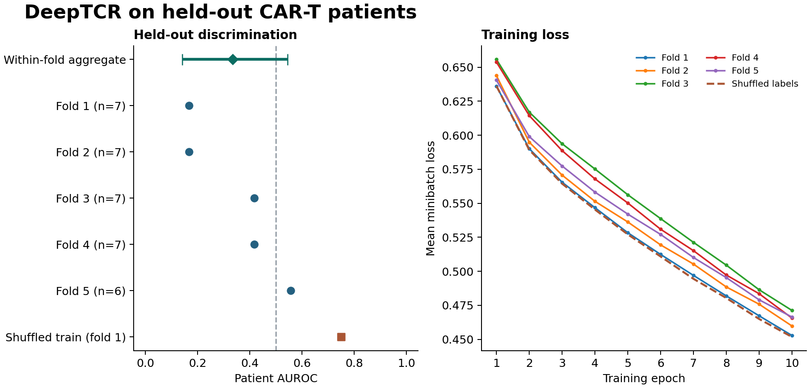
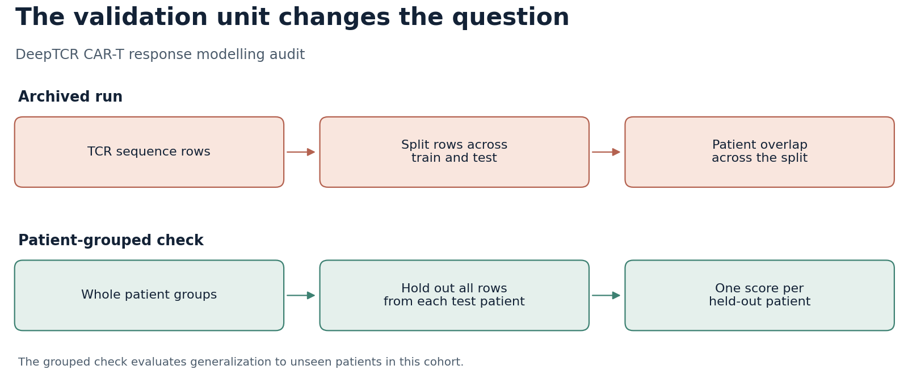

# DeepTCR and CD19 CAR-T response

CSIR-IGIB research trainee project by Mateenah Jahan, supervised by Dr. Sherry Bhalla. The original work explored 239,637 TCRβ sequence records from 34 patients with B-cell lymphoma.

## Patient-separated rerun

The official DeepTCR 2.1.29 sequence model was evaluated across five folds covering all 34 patients. Each test fold held out entire patients from training. All 239,634 sequence records within the model’s 40-residue limit contributed to evaluation. Within-fold patient AUROC was **0.316** (18 of 57 responder–nonresponder pairs correctly ranked). This cohort did not show positive held-out discrimination with this model.

[Full results and limitations](validation/patient-grouped-deeptcr/REPORT.md) · [Code and reproduction steps](validation/patient-grouped-deeptcr/README.md)

## Validation audit

The archived script called DeepTCR’s sequence-level model, `DeepTCR_SS`, with each sequence inheriting its patient’s response label. It supplied numeric `Y`, which selects regression in DeepTCR 2.1.29. The archived split operated on sequences. The [historical report](paper/main.pdf) describes a repertoire-level multiple-instance learning design and is preserved as submitted.

- **The historical AUC is an epoch summary.** The 100 scores used to report 0.754 ± 0.035 match the first 100 test AUC entries in the training log. Those entries span five folds. Repeated epochs on the same test folds do not provide 100 independent evaluations.
- **The archived “attention” scores came from a fallback.** The 239,634 saved values reproduce the script's seeded random fallback. The reported top-sequence and motif interpretation is therefore unsupported by that artifact.
- **Every replay mixed patients across the split.** Replaying the DeepTCR 2.1.29 splitter on the archived input produced 34/34 patients in both training and test in each of 100 draws, in both row-splitting modes checked. An explicitly patient-grouped five-fold check had zero overlap. The archived script and log leave some execution settings unresolved, so this is a splitter replay.
- **The rerun evaluates unseen patients.** Each test patient’s entire repertoire is held out, the V/J vocabulary is fitted on training patients, and one score per patient is evaluated. See the [patient-separated rerun](#patient-separated-rerun) above.

## How the project developed

1. **Prepare the repertoires.** Extract and filter TCRβ sequences, check sample counts, and build inputs for DeepTCR.
2. **Train sequence classifiers.** The executed supervised script is [06_monte_carlo_training.py](scripts/06_monte_carlo_training.py). It is the starting point for interpreting the archived log and plots.
3. **Explore repertoire structure.** The unsupervised scripts cluster sequence representations. Treat the resulting groups as descriptive patterns in this cohort.
4. **Check the reported results.** [07_post_training_analysis.py](scripts/07_post_training_analysis.py) reads the training logs. [08_attention_weight_extraction.py](scripts/08_attention_weight_extraction.py) contains the fallback reproduced in this audit.

## What to open

| Material | Link |
| --- | --- |
| Original trainee submission | [Historical report PDF](paper/main.pdf) |
| Figures from the trainee report | [Historical figures](figures/paper_final/) |
| Patient-separated rerun | [Results, controls and limitations](validation/patient-grouped-deeptcr/REPORT.md) |
| Validation correction | [Audit summary](#validation-audit) and [validation diagram](figures/audit/validation-unit.png) |
| Research software | [DeepTCR framework paper](https://pmc.ncbi.nlm.nih.gov/articles/PMC7952906/) and [upstream compatibility acknowledgment](https://github.com/sidhomj/DeepTCR/commit/715f6642292a296aa22ffba1b219908fd5af5c5f) |
| Historical repository guide | [README before the validation audit](https://github.com/MateenahJAHAN/Final_Deliverable_DeepTCRResearch_Mateenah_Jahan_CSIR/blob/4f4c7530194383952c77af05fa13dfa210f8abe5/README.md) |

This audit reports aggregate checks. Reuse or redistribution of patient-associated files requires confirmation of their provenance and permissions with the study supervisor.
