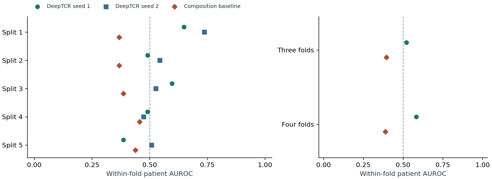

# Repeated patient-held-out evaluation

The study completed **57 ten-epoch DeepTCR fits** on 34 patients and 239,634 eligible records. Every evaluation scored each patient exactly once. Five patient partitions crossed with two training seeds produced ten five-fold evaluations. One three-fold and one four-fold evaluation checked sensitivity to fold count.

| Primary analysis | Median (minimum–maximum) |
| --- | ---: |
| DeepTCR within-fold AUROC, ten evaluations | 0.518 (0.386–0.737) |
| Composition within-fold AUROC, five partitions | 0.386 (0.368–0.456) |
| DeepTCR minus baseline on matched partitions | 0.132 (-0.053–0.368) |
| Absolute difference between training seeds within a partition | 0.070 (0.018–0.123) |

DeepTCR scored higher than the matched baseline in 9 of 10 evaluations. The baseline scored higher in 1, with 0 ties.

## All evaluations

| Folds | Patient split seed | Training seed | DeepTCR AUROC | Composition AUROC | Comparable pairs |
| ---: | ---: | ---: | ---: | ---: | ---: |
| 5 | 20261121 | 20261201 | 0.649 | 0.368 | 57 |
| 5 | 20261121 | 20261202 | 0.737 | 0.368 | 57 |
| 5 | 20261122 | 20261201 | 0.491 | 0.368 | 57 |
| 5 | 20261122 | 20261202 | 0.544 | 0.368 | 57 |
| 5 | 20261123 | 20261201 | 0.596 | 0.386 | 57 |
| 5 | 20261123 | 20261202 | 0.526 | 0.386 | 57 |
| 5 | 20261124 | 20261201 | 0.491 | 0.456 | 57 |
| 5 | 20261124 | 20261202 | 0.474 | 0.456 | 57 |
| 5 | 20261125 | 20261201 | 0.386 | 0.439 | 57 |
| 5 | 20261125 | 20261202 | 0.509 | 0.439 | 57 |
| 3 | 20261121 | 20261201 | 0.521 | 0.396 | 96 |
| 4 | 20261121 | 20261201 | 0.583 | 0.389 | 72 |

## What the estimates measure

The primary AUROC weights every responder–nonresponder comparison made within its own test fold equally. Grouping by patient keeps one patient's sequences together. DeepTCR fits its V/J vocabulary on training patients. The baseline uses sequence-length summaries and normalized amino-acid monomer and dimer frequencies. Its scaler and logistic regression are fitted on the matching training patients.

The ranges describe variation across splits and fits of the same 34 people. The evaluations share patients, and the ranges are descriptive. The study supplies internal validation. An independent cohort is needed to assess generalization.

[Declared study plan](repeat_plan.json) · [Aggregate result JSON](repeat_results.json) · [Results CSV](repeat_results.csv) · [Reproduction](../../SETUP.md)
